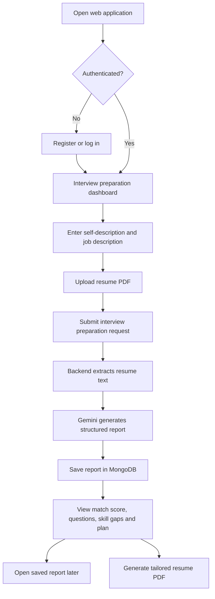
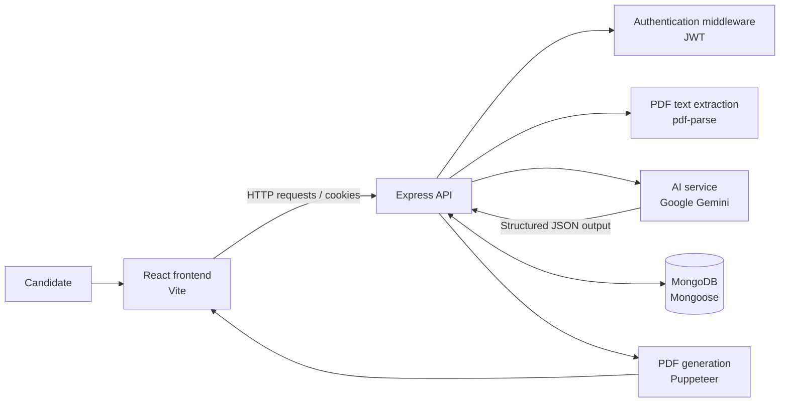
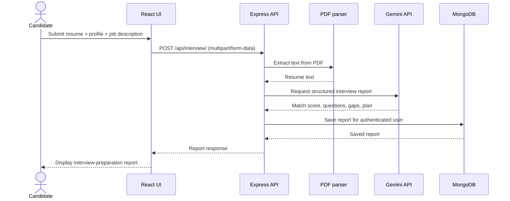

::: {align="center"}
# Saksham AI

**Resume-aware interview preparation, skill-gap analysis, and tailored
career guidance.**

A full-stack web application that uses a candidate's resume,
self-description, and target job description to generate a structured
interview-preparation report.
:::Overview
Preparing for a role is easier when the preparation is specific to the
job. This application lets a user submit a resume PDF, describe their
background, and provide a job description. The backend extracts resume
text and uses Google's Gemini API to generate a structured report that
includes a profile match score, technical and behavioral interview
questions, skill gaps, and a day-by-day preparation plan.

The application also includes account registration and login, report
history, report details, and an AI-generated resume PDF tailored to the
target role.
Project status: Development project. Configure the required
services and test the complete flow before using it with real
candidate data or presenting it as production-ready.

Key Features
- Account management --- register, log in, retrieve the current
  user, and log out.
- Resume PDF parsing --- upload a PDF resume; the backend extracts
  its text for analysis.
- Job-specific interview report --- provide a self-description and
  target job description to generate a structured report.
- Match score --- receive an AI-generated profile-to-role match
  score.
- Technical interview preparation --- suggested questions,
  interviewer intent, and answer guidance.
- Behavioral interview preparation --- behavioral questions with
  explanations and answer guidance.
- Skill-gap analysis --- identify potential missing skills and
  categorize their severity as low, medium, or high.
- Day-wise preparation plan --- receive a sequence of focused
  tasks for interview preparation.
- Saved report history --- retrieve previous reports and open an
  individual report.
- Tailored resume PDF --- generate a role-oriented resume PDF from
  the saved candidate and job information.
Product Flow

System Architecture

Technology Stack
  Layer                           Technologies
  Frontend                        React 19, React Router, Vite, Sass
  Backend                         Node.js, Express 5
  Database                        MongoDB, Mongoose
  AI integration                  Google GenAI SDK, Gemini model
  AI response validation/schema   Zod, zod-to-json-schema
  Authentication                  JSON Web Tokens, bcryptjs, cookie-parser
  Resume parsing                  pdf-parse, Multer
  PDF generation                  Puppeteer
  HTTP client                     Axios
  Code quality                    ESLint
Repository Structure
ai_interview_platform/
├── Frontend/
│   ├── public/
│   ├── src/
│   │   ├── features/
│   │   │   ├── auth/          # Registration, login and auth state
│   │   │   └── interview/     # Interview dashboard and report flow
│   │   ├── app.routes.jsx
│   │   ├── App.jsx
│   │   └── main.jsx
│   ├── package.json
│   └── vite.config.js
├── Backend/
│   ├── src/
│   │   ├── config/            # Database connection
│   │   ├── controllers/       # Request handlers
│   │   ├── middlewares/       # Authentication and file upload
│   │   ├── models/            # User and report schemas
│   │   ├── routes/            # API routes
│   │   └── services/          # Gemini and PDF services
│   ├── server.js
│   └── package.json
└── README.md
Getting Started
Prerequisites
Install the following before starting:
- Node.js (LTS recommended) and npm
- Git
- MongoDB instance (local or hosted)
- Google Gemini API key from Google AI
  Studio
1. Clone the repository
git clone https://github.com/sakshibansal73/ai_interview_platform.git
cd ai_interview_platform
2. Configure the backend
cd Backend
npm install
Create a Backend/.env file with the following variables:
MONGO_URI=your_mongodb_connection_string
JWT_SECRET=replace_with_a_long_random_secret
GOOGLE_GENAI_API_KEY=your_google_genai_api_key
Do not commit .env files or expose credentials in screenshots, logs,
or source code.
3. Start the backend
From the Backend/ directory:
npm run dev
The server is configured to listen on port 3000. The backend also
expects MongoDB to be reachable using MONGO_URI.
4. Configure and start the frontend
Open a second terminal:
cd Frontend
npm install
npm run dev
Vite normally serves the frontend at http://localhost:5173.

The backend CORS configuration currently allows http://localhost:5173
and enables credentials. If you change the frontend origin, update the
backend CORS configuration to match.
5. Try the application
1. Register an account and log in.
2. Provide a self-description and the target job description.
3. Upload a PDF resume within the current 3 MB upload limit.
4. Generate and review the interview report.
5. Open saved reports or try generating a tailored resume PDF.
Note: Exact behavior depends on valid environment variables, a
reachable MongoDB database, Google Gemini API availability, and the
local Puppeteer runtime.
API Reference
Base URL for local development: http://localhost:3000
Authentication
  Method            Endpoint               Purpose           Access
  POST            /api/auth/register   Create an account Public

  POST            /api/auth/login      Authenticate a    Public
                                           user              

  GET             /api/auth/logout     Log out and clear Public
                                           the token cookie  

  GET             /api/auth/get-me     Retrieve the      Authenticated
                                           current user's
                                       details           
Interview Reports
  Method            Endpoint                                         Purpose             Access
  POST            /api/interview/                                Generate a report   Authenticated
                                                                     from resume PDF,
                                                                     self-description,
                                                                     and job description 

  GET             /api/interview/                                List the current    Authenticated
                                                                     user's report
                                                                     history             

  GET             /api/interview/report/:interviewId             Retrieve one report Authenticated
                                                                     belonging to the
                                                                     current user        

  POST            /api/interview/resume/pdf/:interviewReportId   Generate a tailored Authenticated
                                                                     resume PDF from a
                                                                 saved report        
For report generation, send a multipart/form-data request containing a
resume PDF file plus selfDescription and jobDescription fields.
Authenticated requests use the token cookie.
Interview Report Data Flow

Security and Privacy Notes
- Keep API keys, database credentials, and JWT secrets in environment
  variables.
- Never commit .env files. If a secret was committed, rotate it;
  deleting the file in a later commit does not remove it from Git
  history.
- The current implementation uses JWTs in cookies. Before production
  deployment, review cookie options (httpOnly, secure, and
  sameSite), CSRF protection, token invalidation, and session
  handling.
- Add request validation, centralized error handling, rate limiting,
  logging without sensitive data, and stronger upload validation
  before public deployment.
- Resume files and extracted resume text can contain personal
  information. Use test data while developing and define retention,
  deletion, access-control, and privacy policies before collecting
  real user data.
- Treat AI output as a preparation aid, not a guarantee of hiring
  outcomes. Users should review generated suggestions for accuracy.
Current Limitations
- The backend CORS origin is configured for local development
  (http://localhost:5173).
- Resume uploads are limited to 3 MB by the current Multer
  configuration.
- The report-generation flow expects a PDF resume.
- The backend relies on external MongoDB and Gemini services.
- Automated backend tests are not currently configured in the package
  scripts.
- Production deployment, observability, and comprehensive error
  handling need additional work.
Future Scope of Improvement
AI and personalization
- Add selectable interview modes: behavioral, technical, HR, and
  system design.
- Support role-specific question difficulty and configurable interview
  length.
- Include citations or evidence linking suggestions to resume sections
  and job requirements.
- Add a conversational mock interview with follow-up questions and
  answer feedback.
- Track progress across attempts and adapt the preparation plan to
  weak areas.
Resume and job intelligence
- Add DOCX support and more robust PDF parsing with clear
  extraction-error feedback.
- Compare resume bullets against job requirements and suggest
  evidence-based rewrites.
- Add an ATS-oriented checklist while avoiding claims of guaranteed
  ATS performance.
- Support multiple job descriptions and side-by-side role comparisons.
Engineering and reliability
- Add automated unit, integration, and end-to-end tests.
- Validate request bodies and uploaded files consistently; add upload
  timeouts and clearer error responses.
- Move long-running AI and PDF jobs to a background queue with
  progress updates and retry handling.
- Add structured logging, monitoring, API documentation, and
  health-check endpoints.
- Add pagination and search for report history; index frequently
  queried MongoDB fields.
- Add CI checks for linting, tests, dependency auditing, and build
  validation.
Security, privacy, and deployment
- Configure secure cookies, CSRF protections where appropriate, rate
  limiting, and account recovery.
- Add user-controlled report deletion and documented data-retention
  policies.
- Deploy the frontend and backend with environment-specific
  configuration and restricted CORS origins.
- Add secret scanning and dependency vulnerability checks to the
  development workflow.
- Evaluate accessibility, responsive layouts, and performance on
  mobile devices.
Development Commands
Frontend
cd Frontend
npm run dev
npm run build
npm run lint
npm run preview
Backend
cd Backend
npm run dev
Contributing
1. Create a feature branch.
2. Make a focused change and add or update tests where possible.
3. Run frontend lint/build checks and verify the relevant user flow.
4. Document configuration changes and update this README.
5. Open a pull request describing the change and how it was tested.
Acknowledgements and Project Attribution
If this repository is based on a tutorial, starter repository, or
third-party code, retain the original license and attribution required
by that source. Clearly document which parts are inherited and which
features or improvements you implemented yourself.
::: {align="center"}
**Built to make interview preparation more structured, targeted, and
actionable.**
:::
